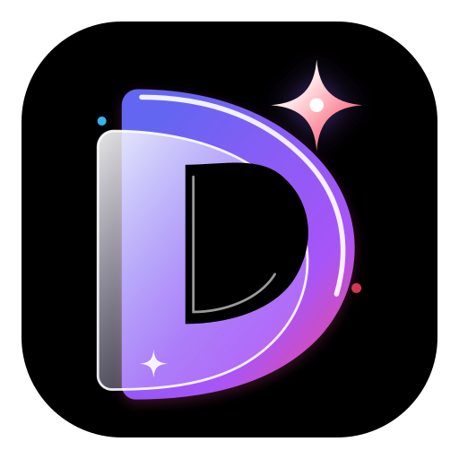
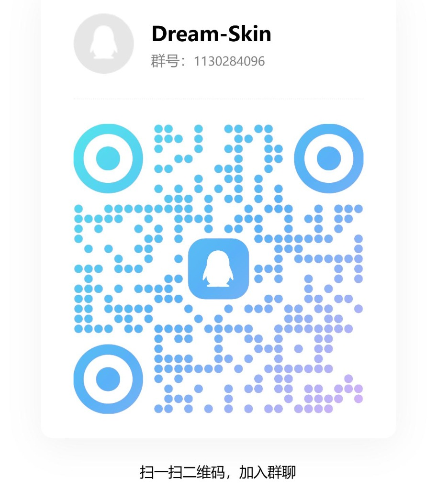

# Dream Skin

<p align="center">
  
</p>

<p align="center"><strong>为 AI 桌面客户端换上喜欢的背景，集中管理主题与界面外观。</strong></p>

<p align="center">
  <a href="#下载与安装">下载安装</a> ·
  <a href="#主要功能">主要功能</a> ·
  <a href="#快速上手">快速上手</a> ·
  <a href="#平台与客户端支持">平台支持</a> ·
  <a href="#使用须知">使用须知</a> ·
  <a href="#从源码构建">源码构建</a> ·
  <a href="#交流与支持">交流支持</a>
</p>

Dream Skin 是一款跨平台的 AI 桌面客户端外观与主题管理器。支持 Codex、Claude Desktop（Code 页面）及 DSH（DeepSeek Harness），提供图片/视频动态背景、精细透明度调节、社区主题一键应用等功能。

---

## 下载与安装

**最新发布版本：`v3.4.0`** · [前往 GitHub Releases 下载](https://github.com/xxloocee/Dream-Skin/releases)

| 平台 | 版本类型 | 系统要求 | 安装包文件 |
| --- | --- | --- | --- |
| **Windows** | 安装版 (Setup) | Windows 10/11 x64 | `DreamSkin-v3.4.0-windows-x64-setup.exe` |
| **Windows** | 便携版 (Portable) | Windows 10/11 x64 | `DreamSkin-v3.4.0-windows-x64-portable.zip` |
| **macOS** | Intel 芯片 | macOS 13+ | `DreamSkin-v3.4.0-macos-x64.dmg` |
| **macOS** | Apple Silicon | macOS 13+ | `DreamSkin-v3.4.0-macos-arm64.dmg` |

- **先安装目标客户端**：运行前请确保已安装 Codex、Claude Desktop 或 DSH。
- **开箱即用**：安装包已内置运行环境，无需额外部署 Node.js。
- **便携版须知**：请完整解压 zip 压缩包后再运行 `DreamSkin.exe`。
- **完整性校验**：可在发布页使用 `SHA256SUMS.txt` 核对安装包哈希。

> [!NOTE]
> 项目自 v3.4.0 起正式升级为 **Dream Skin** 品牌，原有主题与配置将自动平滑继承。详见 [品牌迁移说明](docs/dream-skin-migration.md)。

---

## 主要功能

- 🎨 **丰富的主题与动态背景**：支持 PNG、JPEG、WebP、GIF 动图以及 MP4 动态视频，支持导入/导出 `.cdskin` 主题包。
- 🌐 **DreamSkin 社区主题库**：软件内置社区主题市场，直接浏览、搜索并一键下载海量精选主题。
- 🎛️ **精细的外观调节**：自由调节背景位置、缩放方式、全窗口/独立面板透明度、暗黑/明亮适配及强调色。
- 🎬 **自定义启动动画**：支持为客户端配置启动视频动画，带来沉浸式启动体验。
- 🔄 **安全无损与快速恢复**：不修改客户端官方二进制，随时一键重置或退出换肤，恢复官方原始外观。
- 🚀 **应用内自动更新**：支持检查新版本，内置数字签名校验，一键升级更省心。

---

## 快速上手

1. **选择应用与主题**：打开 Dream Skin 管理器，在侧边栏选择目标客户端；从本地或社区挑选主题，也可拖入自己的图片/视频。
2. **微调外观**：在右侧面板预览效果，按需调整背景对齐方式与透明度。
3. **应用皮肤**：点击 **应用皮肤** 即可生效（首次连接或需要调试端口时可能提示重启目标客户端）。
4. **日常管理**：支持随时暂停/继续换肤、重新加载或一键恢复默认外观。

---

## 平台与客户端支持

| 目标客户端 | Windows | macOS | 首次使用说明 |
| --- | :---: | :---: | --- |
| **Codex** | ✅ | ✅ | 直接启动即可，管理器自动建立注入连接 |
| **Claude Desktop**<br>(Code 页面) | ✅ | 规划中 | 需在 Claude 中开启 `Developer → Enable Main Process Debugger` |
| **DSH rc / Next** | ✅ | 规划中 | 自动识别版本与连接，应用时按需接管调试通道 |

> 平台详细说明参见：[Windows 运行时与故障排查](windows/README.md) · [macOS 使用说明](macos/GUI使用说明.md)

---

## 使用须知

### 动态视频背景规范
- **格式**：标准 MP4 格式（H.264 / HEVC 编码）
- **规格建议**：分辨率不超过 4K，文件大小 ≤ 128 MiB，时长 ≤ 60 秒，帧率 ≤ 60 FPS
- **循环播放**：建议在制作素材时做好首尾画面无缝衔接

### 安全与兼容性
- **非侵入式设计**：本程序不会反编译或篡改客户端核心可执行文件，不请求系统管理员提权。
- **SmartScreen 提示**：由于未购买商业代码签名证书，Windows SmartScreen 可能会出现“未知发布者”提示，点击“更多信息 -> 仍要运行”即可。
- **客户端更新**：当目标客户端重大升级导致注入失效时，可通过管理器重新应用主题或等待适配更新。

---

## 从源码构建

### 环境要求
- **所有平台**：Node.js 22.x
- **Windows**：.NET SDK 8.0、WebView2 Runtime
- **macOS**：Xcode Command Line Tools

### 构建步骤

```bash
# 1. 克隆仓库并安装依赖
git clone https://github.com/xxloocee/CodexDreamSkinManager.git
cd CodexDreamSkinManager
npm ci

# 2. 构建管理器
# Windows (PowerShell):
.\build.ps1

# macOS:
bash macos/scripts/build-app.sh
```

构建产物将分别输出至 `build/DreamSkin/` (Windows) 或 `build/macos/Dream Skin.app` (macOS)。更多开发规范参见 [CONTRIBUTING.md](CONTRIBUTING.md)。

---

## 交流与支持

欢迎加入交流群反馈问题、提出建议或分享自定义主题：

<p align="center">
  
  <br>
  <strong>QQ 交流群：1130284096</strong>
</p>

---

## 致谢与许可

- 本项目换肤运行时基于 [Fei-Away/Codex-Dream-Skin](https://github.com/Fei-Away/Codex-Dream-Skin) 开发，感谢原作者及开源社区贡献。
- 桌面可视化管理界面由群友“花落情已逝”最初基于上游项目设计开发，本作者基于此进行全面升级和重构。
- 本项目采用 [MIT License](LICENSE) 开源协议。第三方组件及素材引用详见 [THIRD_PARTY_NOTICES.md](THIRD_PARTY_NOTICES.md)。
